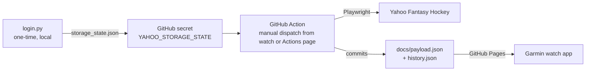

# Yahoo Fantasy Hockey Scraper

Scrapes your Yahoo Fantasy Hockey team on demand via a GitHub Action. It
publishes a small JSON file (via GitHub Pages) with day/week/season point totals
for each of your players — counting only points scored while they were in your
**starting** lineup (never points scored while benched/IR).

This is a standalone project meant to live in its own GitHub repository —
nothing in here depends on anything else in this workspace, and nothing
else in this workspace depends on it.



## Known limitation: scraping is best-effort

Yahoo's fantasy pages require a login and are rendered client-side. The
scraper identifies players through Yahoo's `/nhl/players/<id>` links and
reads the assigned lineup slot and fantasy points from the roster row's
`td.edit` and `td.pts` cells. It also reads the current game stat columns
from the row headers: G, A, PPP, SOG, HIT, and BLK for skaters; GA and SV
for goalies. Game info includes the opponent and, when Yahoo shows a live
scoreboard, the current period and clock. Yahoo may change this page markup;
if scraping fails, use `debug_dump.py` (see Troubleshooting) to inspect the
page.

## 1. Create the GitHub repo

Create a new **public** repository yourself (any name, e.g.
`fantasy-hockey-scraper`) and push the contents of this `FantasyScraper/`
folder to it as the repo root:

```powershell
cd FantasyScraper
git init
git add .
git commit -m "Initial commit"
git branch -M main
git remote add origin https://github.com/<you>/<repo>.git
git push -u origin main
```

Public is required for the simple no-auth hosting approach below (private
repos need a paid plan for Pages, or you'd need to add an auth token to the
watch's request instead).

## 2. One-time local login

Requires Python 3.10+ and Google Chrome/Chromium available to Playwright.

```powershell
cd scraper
python -m venv .venv
.venv\Scripts\Activate.ps1
pip install -r requirements.txt
playwright install chromium
python login.py
```

A real browser window opens. Log in to Yahoo yourself (complete 2FA if
asked), navigate to your fantasy hockey team page, then press Enter in the
terminal. This saves `storage_state.json` — **never commit this file**,
it's already in `.gitignore`.

## 3. Add GitHub secrets and variables

In your new repo: **Settings > Secrets and variables > Actions**.

- **Secrets** tab — add:
  - `YAHOO_STORAGE_STATE` — paste the entire contents of
    `scraper/storage_state.json`
- **Variables** tab — add:
  - `YAHOO_LEAGUE_ID` — from your league's URL, e.g.
    `https://hockey.fantasysports.yahoo.com/hockey/<LEAGUE_ID>/...`
  - `YAHOO_TEAM_ID` — from your team's URL,
    `.../<LEAGUE_ID>/<TEAM_ID>` (usually `1`-`12`)
  - `YAHOO_SEASON_START` *(optional)* — `YYYY-MM-DD` for the first day of
    the season, used by `backfill.py` and to bound season totals

## 4. Enable GitHub Pages

**Settings > Pages** → under "Build and deployment", set **Source** to
"Deploy from a branch", branch `main`, folder `/docs`. Save.

Your payload will be published at:
```
https://<you>.github.io/<repo>/payload.json
```
(It won't exist until the Action runs once — see step 5.)

## 5. Run the Action

The action runs on demand only. From the repository's **Actions** tab, select
"Scrape Yahoo Fantasy Hockey" → **Run workflow**. The Connect IQ watch app can
also start it: configure a fine-grained GitHub token in the app's **GitHub
Actions token** setting, with **Actions: write** permission restricted to this
repository, then hold the watch's middle-left **Up** button and confirm
**Refresh?**. The token is stored on the watch and can be extracted; use a
repository-limited token and do not commit or share it. Check the run logs; if
`scrape.py` reports 0 players found, see Troubleshooting below.

## 6. (Optional) Backfill the season so far

The scheduled Action only accumulates data from when it starts running. To
backfill earlier days in the season so far, run this **locally** (it's too
slow for a scheduled Action run):

```powershell
cd scraper
$env:YAHOO_LEAGUE_ID = "<league id>"
$env:YAHOO_TEAM_ID = "<team id>"
$env:YAHOO_SEASON_START = "2025-10-07"
python backfill.py
```

Then commit and push the updated `docs/history.json` yourself.

## Troubleshooting

If `scrape.py` isn't finding your players, it prints a page title, URL
(without query parameters), roster-row count, and player-link count. A Yahoo
sign-in or consent page indicates the saved session was not accepted; a
normal roster page with zero matching player links likely means Yahoo changed
its markup. To inspect the page locally:

```powershell
cd scraper
$env:YAHOO_LEAGUE_ID = "<league id>"
$env:YAHOO_TEAM_ID = "<team id>"
python debug_dump.py
```

The scraper waits for the page's DOM and roster table instead of waiting for
all network activity to stop, since Yahoo can keep background requests open.
If the workflow reports that the roster table did not load, verify the team
URL and saved Yahoo session, then run `debug_dump.py` to inspect what loaded.

This saves `debug_page.html` and `debug_page.png` of today's roster page.
Open the screenshot to see what Yahoo actually rendered, and inspect the
HTML for the real table/row structure, then adjust `parse_roster_rows()`
in `scrape.py` to match (e.g. a different row/column selector, or a
different way the slot/points values are laid out).

## Payload format

`docs/payload.json`:
```json
{
  "updated_at": "2026-01-15T18:00:00Z",
  "updated_at_local": "2026-01-15T11:00-07:00",
  "week_start": "2026-01-12",
  "players": [
    {
      "name": "Player Name",
      "position": "C",
      "week_points": 7.25,
      "season_points": 54.0,
      "today": {
        "started": true,
        "points": 3.5,
        "stats": {
          "goals": 1,
          "assists": 0,
          "ppp": 1,
          "shots": 4,
          "hits": 2,
          "blocks": 0
        },
        "slot": "C",
        "game_info": "vs BOS"
      }
    }
  ]
}
```
