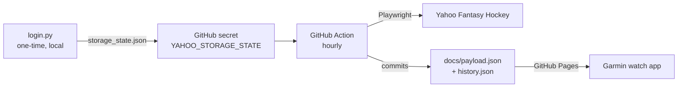

# Yahoo Fantasy Hockey Scraper

Scrapes your Yahoo Fantasy Hockey team hourly via a GitHub Action, and
publishes a small JSON file (via GitHub Pages) with day/week/season point
totals for each of your players — counting only points scored while they
were in your **starting** lineup (never points scored while benched/IR).

This is a standalone project meant to live in its own GitHub repository —
nothing in here depends on anything else in this workspace, and nothing
else in this workspace depends on it.



## Known limitation: scraping is best-effort

Yahoo's fantasy pages require a login and are rendered client-side, so I
could not inspect the real page markup while building this. The parsing in
`scraper/scrape.py` (`parse_roster_rows`) is based on Yahoo's well-known,
long-standing page conventions (a roster table, one row per player, a link
to `/hockey/players/<id>`, a slot abbreviation like `C`/`LW`/`D`/`BN`, and a
trailing points number) — but it is **not guaranteed to match pixel-for-pixel
with what Yahoo currently renders**. If `scrape.py` runs but finds zero/wrong
players, use `debug_dump.py` (see Troubleshooting) to see the real page and
adjust `parse_roster_rows()`.

## 1. Create the GitHub repo

Create a new **public** repository yourself (any name, e.g.
`fantasy-hockey-scraper`) and push the contents of this `FantasyScraper/`
folder to it as the repo root:

```powershell
cd FantasyScraper
git init
git add .
git commit -m "Initial commit"
git branch -M main
git remote add origin https://github.com/<you>/<repo>.git
git push -u origin main
```

Public is required for the simple no-auth hosting approach below (private
repos need a paid plan for Pages, or you'd need to add an auth token to the
watch's request instead).

## 2. One-time local login

Requires Python 3.10+ and Google Chrome/Chromium available to Playwright.

```powershell
cd scraper
python -m venv .venv
.venv\Scripts\Activate.ps1
pip install -r requirements.txt
playwright install chromium
python login.py
```

A real browser window opens. Log in to Yahoo yourself (complete 2FA if
asked), navigate to your fantasy hockey team page, then press Enter in the
terminal. This saves `storage_state.json` — **never commit this file**,
it's already in `.gitignore`.

## 3. Add GitHub secrets and variables

In your new repo: **Settings > Secrets and variables > Actions**.

- **Secrets** tab — add:
  - `YAHOO_STORAGE_STATE` — paste the entire contents of
    `scraper/storage_state.json`
- **Variables** tab — add:
  - `YAHOO_LEAGUE_ID` — from your league's URL, e.g.
    `https://hockey.fantasysports.yahoo.com/hockey/<LEAGUE_ID>/...`
  - `YAHOO_TEAM_ID` — from your team's URL,
    `.../<LEAGUE_ID>/<TEAM_ID>` (usually `1`-`12`)
  - `YAHOO_SEASON_START` *(optional)* — `YYYY-MM-DD` for the first day of
    the season, used by `backfill.py` and to bound season totals

## 4. Enable GitHub Pages

**Settings > Pages** → under "Build and deployment", set **Source** to
"Deploy from a branch", branch `main`, folder `/docs`. Save.

Your payload will be published at:
```
https://<you>.github.io/<repo>/payload.json
```
(It won't exist until the Action runs once — see step 5.)

## 5. Run the Action

**Actions** tab → "Scrape Yahoo Fantasy Hockey" → **Run workflow** (the
`workflow_dispatch` trigger lets you run it on demand instead of waiting
for the hourly schedule). Check the run logs; if `scrape.py` reports 0
players found, see Troubleshooting below.

## 6. (Optional) Backfill the season so far

The hourly Action only accumulates data from when it starts running. To
backfill earlier days in the season so far, run this **locally** (it's too
slow for a scheduled Action run):

```powershell
cd scraper
$env:YAHOO_LEAGUE_ID = "<league id>"
$env:YAHOO_TEAM_ID = "<team id>"
$env:YAHOO_SEASON_START = "2025-10-07"
python backfill.py
```

Then commit and push the updated `docs/history.json` yourself.

## Troubleshooting

If `scrape.py` isn't finding your players:

```powershell
cd scraper
$env:YAHOO_LEAGUE_ID = "<league id>"
$env:YAHOO_TEAM_ID = "<team id>"
python debug_dump.py
```

This saves `debug_page.html` and `debug_page.png` of today's roster page.
Open the screenshot to see what Yahoo actually rendered, and inspect the
HTML for the real table/row structure, then adjust `parse_roster_rows()`
in `scrape.py` to match (e.g. a different row/column selector, or a
different way the slot/points values are laid out).

## Payload format

`docs/payload.json`:
```json
{
  "updated_at": "2026-01-15T18:00:00Z",
  "week_start": "2026-01-12",
  "players": [
    {
      "name": "Player Name",
      "position": "C",
      "week_points": 7.25,
      "season_points": 54.0,
      "today": {
        "started": true,
        "points": 3.5,
        "slot": "C",
        "game_info": "vs BOS"
      }
    }
  ]
}
```
